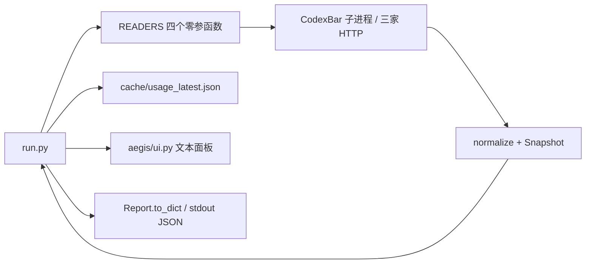
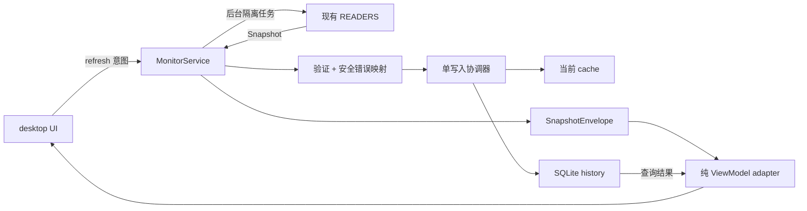

# Aegis Token Monitor：下一版 UI / UX 与实施设计

设计日期：2026-09-12（Asia/Shanghai）  
依据：当前工作区、Git 历史、现有测试与验收记录。**仅设计，不施工。**

> **v0.4.2 修订（2026-09-13，用户指令）**：额度条填充色整体换为「极光渐变」
> （0% #34D399 翡翠绿 → 50% #60A5FA 亮蓝 → 75% #A78BFA 亮紫 → 100% #F87171
> 珊瑚红）。v0.4.1 的 蓝→琥珀 锚点在 RGB 插值中段（约 60–80%）退化为灰色，
> 用户否决后废弃；新色带全程鲜艳。插值算法与告警语义不变。

> **v0.4.1 修订（2026-09-13 第二轮，用户指令，覆盖以下 v0.4 条款）**：
>
> - 首页**删除全部"详情 ›"入口**：卡片纯展示（不可点击、无手形光标、无选中
>   描边、安静细边框）；键盘焦点只属于刷新 / 历史等实际按钮。
> - 额度条加粗为 **12 DIP 胶囊**，填充色按每根条自己的已用百分比在锚点间
>   连续插值（0% #75C9B2 青绿 → 50% #729FF0 蓝 → 80% #DFB777 琥珀 → 100%
>   #E38D91 珊瑚红）；纯视觉映射，不改变"额度较低"告警文案。
> - DeepSeek 改为**简洁钱包卡**：只保留服务名、简短状态、并排的
>   "钱包剩余 ¥XX.XX / 已花费 ¥XX.XX"。删除首页的累计充值说明、配置路径、
>   缺少总额提示、已用比例说明与额度条。已花费仅在累计充值与余额口径一致时
>   计算（充值 − 余额；上游无消费累计字段），否则显示"已花费 —"，
>   口径说明集中放在悬停提示。
> - 底部观察记录区**删除"Token 统计尚未接入"**开发状态；不新增装饰填补。

> **v0.4 修订（2026-09-13）**：本文是 v0.2 施工前的历史设计稿。v0.4 已按
> `docs/UI_POLISH_CC_BRIEF.md` 实施并同步根目录 [DESIGN.md](../DESIGN.md)
> （版本 0.4）。与本文冲突的旧表述**以 DESIGN.md v0.4 为准**，已明确替换：
>
> - 首页不再是 2×2 卡片，而是**四行纵向宽卡**（§5 已更新）；方案 B 的 2×2
>   紧凑布局不再采用。
> - 主数字语义是**"X% 已用"**（填充=已用），不再是"5h 剩余"（§5 已更新）。
> - 卡片取内容自然高度；**不存在按窗口高度切换字号的 compact 模式**（v0.3
>   引入、v0.4 移除）；窗口变矮自然出现纵向滚动条。
> - 顶部汇总统计**全部四家**服务，与卡片数量一致。
> - DeepSeek 金额卡以"当前余额"为主信息，累计充值为辅助小字；未登记时不
>   显示进度条，附登记入口说明。
> - 底部记录区名称为**"额度观察记录"**（不再叫"工作足迹"）。

视觉合同：根目录 [DESIGN.md](../DESIGN.md)（0.4）。参考研究与十项比较见 [DESIGN_REFERENCES.md](DESIGN_REFERENCES.md)。本文负责产品/数据/架构与验收，DESIGN.md 负责视觉常量、数字格式、组件状态与文案；用户指令和数据真实性优先，两份文件变更需同步。外部品牌分析不能覆盖项目合同。

## 1. 结论与范围纠正

**推荐方案 A：PySide6 Widgets 极简 Dashboard，普通可缩放桌面窗口，本地 SQLite 保存额度观测历史。** 保留四家 Reader、归一化与 CLI；新增采集服务和展示适配层。第一屏先回答“还能用多少、什么时候重置、这份数据是否可信”。工作足迹采用可核实的额度变化记录；实际 Token 统计通过独立用量源接入后才启用。

三个需要先纠正的前提：

1. **没有找到两个独立已完成版本。** 根目录、子目录、Git 全部可见提交与标签只确认 v0.1 / v0.1.0；当前 HEAD 为 `02e7d40`，冻结标签存在。可比较的是同一版的两个真实阶段，不能称成 v0.1 与 v0.2。没有遍历无关桌面项目，也不排除第二版在未提供的位置。
2. **当前快照不含实际 Token 计数。** Codex / GLM / MiniMax 的额度百分比、DeepSeek 的余额不能换算成 Token。保存更多快照仍然解决不了这一点。
3. **存在历史原料，但没有历史功能。** 项目 `probe_raw/ccs.db` 是旧调查副本：只读检查表结构和行数发现 `proxy_request_logs` 有 6,786 行，存在 input/output/cache token 字段及 `input_token_semantics`；`usage_daily_rollups` 表存在但为 0 行。它不是 Token Monitor 的历史库，不代表当前实时数据库、四家覆盖率或可直接相加的 Token 总量。今天没有读取其中凭据列或请求内容。

交付物：本设计文档 + `UI_NEXT_VERSION_BOARDS.svg` 静态设计板。设计板使用未连接状态和缺失数据占位，不代表实时监控结果。没有 HTML 原型、应用界面实现或新增依赖。

## 2. 两个实际阶段与证据

| 阶段 | 可验证提交 | 解决的问题 | 留下的边界 |
| --- | --- | --- | --- |
| 基础采集阶段 P1–P3 | `4a1431c`、`27180f9`、`edfc242` | dataclass 模型、语义翻转、只读凭据、HTTP、四 Reader、最新成功缓存 | 没有桌面 UI，也没有历史累计 |
| 可用产品阶段 P4–P5 / 冻结 | `bca8769`、`02725b7`、`3cfd47a`、`02e7d40` | CLI、文本面板、watch、启动脚本、自检、z.ai 新窗口兼容、本地时间脚注 | 展示仍是定宽终端，采集串行，历史未接入 |

阅读范围：README、DECISIONS、ARCHITECTURE、ROUTE_REVIEW、RETROSPECTIVE、ACCEPTANCE、任务说明；`aegis/providers/*.py`、model、normalize、cache、credentials、net、ui；`run.py`、`run.bat`、selfcheck、conftest、gitignore；测试中归一化、凭据、网络、Provider、缓存、CLI 与显示的实现和断言。没有读取真实认证文件。测试细节重点审阅边界、故障、时间与泄漏断言。

文档优先级：**实际代码 > 后续修订决策 / Route Review > 早期架构草案**。例如 ARCHITECTURE 的 429 三次停抓方案已被 Route Review M-3 否决，代码也没有该状态机；旧文档的 `read(cfg)` 在实际代码中是 `read()`。文档中的 341 passed 和 4/4 MATCH 是 2026-09-11 历史验收记录，今天没有重新执行在线验收，不能宣称仍为实时通过。

### 当前真实数据流



- 默认模式和 `--json`：依次抓取四家，成功写缓存，**失败没有应用缓存回退**；CLI 返回 0 不等于四家成功。代码没有自动写 `out/usage.json`，`--json` 是标准输出。
- `--watch`：读最新缓存；Codex/GLM/MiniMax TTL 300 秒，DeepSeek 1,800 秒；未到期用 cached，到期调用 Reader；失败有缓存为 stale + error，源时间不变。
- `cache/usage_latest.json` 每家只保留最近成功一条，临时文件 + 原子替换；不是 append-only 历史。
- `logs/` 是开发 Agent 运行记录；`probe_raw/` 是调查样本。两者都不能直接作为生产用量账本。
- 无桌面图形界面、无历史服务、无自动 JSONL 追加、无自有 SQLite 历史库。凭据模块使用 SQLite 只为只读查询 CC Switch 配置。

## 3. 真实字段与 UI 能力矩阵

“需要字段”是当前 Reader 的解析契约，**不保证上游永远提供**。

| Provider | 当前可展示 | 方向 / 解析条件 | 可能缺失与不支持 | 时间来源 |
| --- | --- | --- | --- | --- |
| Codex | 5h、Weekly 已用/剩余、两个 Reset、extras | `used_percent` → from_used；primary/secondary 和 Reset 当前必须存在，否则整家 error | updated_at、extras 可缺；无 actual tokens / balance；extras 不等于 Token 数 | updated_at 来自 CodexBar；另外保存本地 fetched_at |
| z.ai / GLM | 5h、Weekly 已用/剩余、存在时的 Reset | percentage 为已用；unit 3 / 6；缺 percentage 时按 currentValue/usage，现实现还会兜底 0 | 单窗口可缺仍 ok；Reset 可缺；无 balance / actual tokens；raw_status.level 仅详情 | **当前 Reader 不设置 updated_at，始终为空** |
| MiniMax | 5h、Weekly 已用/剩余、两个 Reset | remaining 为剩余 → from_remaining；取 general；两窗口字段和固定跨度都强校验 | 缺字段或跨度变动整家 error；raw_status 数字不解释为“正常/封禁”；无 balance / actual tokens | updated_at 为空，本地抓取时间另存 |
| DeepSeek | Balance 和币种 | 第一条 balance_infos；is_available=false → SERVICE_UNAVAILABLE | **当前 Reader 不提供 5h/Weekly/Reset**，不是加载失败；无 actual tokens | updated_at 为空，本地抓取时间另存 |

显示约束：

- 金额跟随 `currency`：已识别 CNY 才显示 ¥，其他币种显示 ISO 代码。不能把余额变化称为费用消耗，充值/退款也会改变余额。
- used/remaining 使用模型已有值，UI 不再翻转；百分比不能跨 Provider 相加、平均为“总额度”。
- 5h 与 Weekly 是重叠配额窗口，不能相加形成总用量。
- Codex extras 放详情，保留已识别语义；`reset-credits` 不做“立即重置/兑换”动作，未知 extras 不强解释。
- `null` 和 `0` 严格区分。缺失为“暂无数据 / 未提供”，真实 0 才显示 0。
- 不将“配额接口读取成功”解释为“模型推理接口一定正常”。主页“已更新”指数据获取，非服务健康探针。

## 4. 可复用与脆弱点

**稳定可复用**：四 Reader 的来源选择与字段映射、`Window/Balance/Snapshot/Report`、normalize 纯函数、凭据只读策略、TTL 与失败回退语义、离线 fixtures 和现有 CLI。新图形界面消费 Python 对象，不抓屏、不解析文本面板、不反复启动 `run.py --json`。

| 风险及代码证据（函数） | 对下一版的影响 / 处理设计 |
| --- | --- |
| `ui._format_updated` 在源时间缺失时用渲染 now；cached/stale 也可能显示本轮时间 | 不复用其时间回退；服务同时传入原 `CachedEntry.fetched_at_utc` 与最近尝试时间 |
| `ui._extras_footer` 直接输出 reset_description | 新详情不透传原始自由文本；仅白名单化安全显示；冻结 CLI 保持不动 |
| `codex.read` 非零退出仅替换 sk-/Bearer 前缀；`run._fetch_one` 截取原异常 | 不能假定 error.message 安全；新服务只输出固定错误码和中文文案，不记录原 stderr/message |
| `cache._snapshot_from_dict` 缺百分比默认 0/0，宽松 float 解析 | 新缓存入口做原始结构和有限数值验证，拒绝损坏条目，不能靠 UI 美化错误数字 |
| `cache.write_provider` read-modify-write 共用 `.tmp` | 不能四 worker 同时写；使用单写入协调器；新 GUI 运行时禁止同一新版本 CLI 同时写该缓存 |
| z.ai `_compute_used_pct_when_missing` 信息不足也可返回 0 | Snapshot 没有“推导/兜底”来源信息，UI 无法事后恢复；不把零值当作工作量证据。未来字段来源增强独立评估 |
| MiniMax 强跨度、Codex 强 primary/secondary/Reset 校验 | 上游变化可能整家 error；本轮不通过 UI 猜测补值，不改 Reader 契约 |
| 单轮同步串行，Codex timeout 60s、HTTP 默认 10s，GLM 可能换域 | 桌面主线程绝不能直接调用 Reader。网络上限不是启动速度指标；HTTP timeout 也不是严格整轮截止时间 |
| `test_ui` extras 泄漏测试注入 sk- 字串，却只断言不含 Bearer | 测试名不等于覆盖有效；下一版安全验收必须断言完整测试哨兵与尾片段都不出现 |

缓存验证、安全文案和时间信封是新增服务的职责，不侵入 Provider。若后续要修冻结 CLI 或改变 MiniMax 解析规则，应独立列为数据层修复，不混入本轮 UI 施工。

## 5. 首页方案 A：极简 Dashboard（推荐；v0.4 实施版）

> 下方 ASCII 图已按 v0.4 实施更新（2026-09-13）；原始 2×2 草案见 Git 历史。

**普通桌面窗口，四行纵向宽卡 + 一条额度观察记录。** 不做侧边栏、组织入口、首页设置面板或全屏监控墙。

```text
 Aegis Token Monitor      最近刷新 HH:mm:ss  4 家已更新   刷新
 ┌ Codex          ● 已更新   采集于 HH:mm          ┐
 │ 五小时额度            12% 已用 │  本周额度            2% 已用 │
 │ {胶囊额度条，颜色随用量连续变化}  │  {同左}                     │
 │ 重置：今天 21:29 · 约 3 小时后   │  重置：09-19 周五 16:28      │
 ├ z.ai / GLM     ● 已更新   采集 5 分钟前         ┤
 │ （同上两列结构）                          │
 ├ MiniMax        ● 已更新   采集于 HH:mm          ┤
 │ （同上两列结构）                          │
 ├ DeepSeek       ● 已更新                        ┤
 │ 钱包剩余 ¥57.58        已花费 —               │
 └（已花费 — 时悬停提示口径；无额度条、无配置说明正文）┘
 额度观察记录   ●○○––––  有观测记录   历史 ›
```

- **卡片纯展示（v0.4.1）**：无"详情 ›"入口、整卡不可点击、无手形光标与焦点描边。
- 卡片取内容自然高度（正常额度卡约 138 DIP）；窗口变高空余沉底、变矮出滚动条，字号间距不随高度缩放。
- 每个额度区顺序：周期标签（左）+ 已用值（右）→ 12 DIP 胶囊进度条 → 重置时间；五小时与本周等宽。
- 缺失数据显示"暂无数据"（正文样式）且不显示进度条；真实 0% 保持空填充。
- 窄窗口（卡内容 <620 DIP）两额度区上下排列；最小宽 720 DIP 下仍左右排列且文本完整。

读屏顺序：Provider 名和状态 → 已用值 → 重置时间 → 采集时间；DeepSeek 为服务名 → 状态 → 钱包剩余 → 已花费。大数字不使用示例占位值；空数据时不画装饰性进度条或假趋势。

Reset 随对应窗口就地显示，不设独立 Next Reset 卡。小于 24h 显示"今天 21:29 · 约 3 小时后"；较远显示日期星期与时间；悬停给完整日期、时区。Reset 已到但新值未获得，显示"重置时间已到，待确认"，不得直接把额度改成 100%。

优点：四家始终同屏，低点击成本，现有能力几乎全部可利用。缺点：Token 数据未接入时，成就感只能是有限的观测足迹。开发成本中等，主要在后台刷新和状态语义；维护成本较低。**适合度最高。**

## 6. 首页方案 B：稍强可视化 Dashboard（未采用）

> v0.4 修订：方案 B 未采用，其 2×2 紧凑布局不再恢复；底部图表能力由历史页承担。

同样四家卡片，但缩成紧凑 2×2，底部约三分之一增加可切换的“额度变化 / Token Activity”区域。不是先做多个统计卡。

```text
 Aegis Token Monitor                       刷新
 [Codex 5h / Weekly]          [GLM 5h / Weekly]
 [MiniMax 5h / Weekly]        [DeepSeek Balance]
 ┌ 7 日观测 ─── 额度变化 ▾ ─── Provider ▾ ─────────┐
 │ 当前：没有历史记录，不画曲线                    │
 │ 记录后：单 Provider、单窗口，时间 × 剩余额度%     │
 └───────────────────────────────────────────────┘
 Token Activity：尚未接入真实计数源        历史 ›
```

可交付的图表是 **额度观测折线**，不是 Token 曲线。x 为本地时间，y 为剩余百分比（0–100%），每次重置/缺测断线，悬停说明采集时刻、值与来源。余额在独立金额轴显示，绝不与百分比共用 y 轴。

真实 Token 源通过口径验收后，同一区域可切换为按日柱状图。今天的设计不要求虚构柱高；未知日期绘制缺测标记，零是确实覆盖且计数为零的日期。

优点：后续历史成熟时更有积累感，便于比较同一 Provider 的变化。缺点：首次启动空白更大，多一次选择交互，DPI 和图表缺测语义更复杂。开发与维护成本均高于 A（同等数据能力，估计额外约 30%–50% UI 工作量；这是设计估算，不是排期承诺）。目前适合度中等，**不作为下一版主方案**。

## 7. “Token 成就感”的诚实实现

原则：**使用痕迹不等于产出价值，计数不能证明完成了多少有价值的任务。** 不做排行榜、连续签到、每日消耗目标、收益评分、剩余额度用完庆祝。

### A. 当前额度

卡片主数字为剩余，已用为次级文字。默认低饱和蓝灰进度条，余额不画百分比。低额度可用琥珀色提示，例如剩余 ≤10%；该阈值是 UI 设计参数，不是平台故障状态。颜色不能作为唯一提示。

### B. 今日 Token 与当天变化

当前状态：**NOT AVAILABLE YET**。首页仅一句“Token 统计尚未接入”，不展示 0 Tokens。

接入真实计数后：工作足迹显示“今日已记录 {N} Tokens”，副文案标明覆盖来源；小型日内阶梯线表达随时间积累，当前会话新增量可短暂淡入。不以昨日消耗为必须超越的目标，不用向上绿色箭头暗示越多越好。

缺完整覆盖时固定用“已记录”，不能叫“今天全部 AI 用量”。工具首次打开在下午且无法回填上午时，显示“今日自 14:20 起记录”。历史补录可以改变总数，但不触发达标动效。

### C. 7 / 30 日累计

历史页显示“最近 7 日已记录”和“最近 30 日已记录”，附实际覆盖日期与来源；不足 7 天显示“已记录 2/7 天”，不补零。切换 7/30 天不读取 Provider，只查询本地库。

**额度快照只能支持额度历史，Token 累计需要 usage event / 可验证 token counter。** 绝不将 remaining% 差值乘一个想象中的套餐 Token 总量。

### D. 里程碑

100K、500K、1M、5M、10M、50M 是历史刻度，不是消耗目标。真实、去重且口径一致的累计达到后显示“✓ 已记录 1M”，只保留最近一个刻度；完整刻度放历史页。不显示“还差 X，快去使用”。

首次实时跨过刻度，300ms 以内一次淡入；没有弹窗和音效。以统计范围 + 口径版本 + 阈值为唯一键记住反馈已展示。更换来源或口径开启新统计范围，不能偷偷拼成生涯总量。后续校正减少用量时重算，不保留错误达成标记。

### E. 活跃趋势：现在可以做什么

下一版基础能力用七个日标记组成“观测足迹”，每个格子等尺寸，不按烧量放大：

- 实心小点：当天至少发现一对可比较的成功 live 快照，且同窗口 used% 增加。
- 空心小点：当天有观测，但未确认额度增加；**不代表没有 AI 活动**。
- 短横：无可用观测。

只有同一 Provider、相同非空 resets_at、相同 window_minutes、有效有限数值、间隔 ≤2×TTL 的成功观测才比较；负差值、重置、跨度变化、未知 Reset 一律中断。该规则保守地漏掉一些活动，也不乱记活动。DeepSeek 的余额变化只写“余额发生变化”，不点亮 Token 活动点。

文案为“观察到额度变化”，不能写“完成工作”“专注 X 小时”。GLM 新窗口 Reset 缺失时没有足迹证明，这是数据能力限制，UI 不兜底造信号。真正的 7 日 Token Activity 柱状图必须待 Token 源接入。

### F. Provider Contribution

**NOT AVAILABLE YET。** 不用额度使用率、余额减少额、请求次数或套餐价格代替 Token 占比。

启用条件：统一时区与时间范围；已验证的 input/cache 口径；请求级去重；稳定 Provider 映射；四家同范围覆盖情况可说明。若只覆盖其中两家，只能显示“已记录来源中的 Token 分布”，写明缺失者，不能标题叫全 Provider Contribution。分母为零时显示“暂无可比较记录”，不除零、不等分成 25%。

## 8. 状态系统：数据来源、完整性、错误分开

不往旧 Snapshot 硬塞六个新 status。它目前只有 ok/error 与 live/cached/stale。新增 ViewModel 用三个维度表示：freshness、completeness、availability；保留原始来源状态供内部判定。

| 设计状态 | 首页文案 / 视觉 | 判定与行为 |
| --- | --- | --- |
| LIVE | 青绿色小点 + 已更新 | 本次请求成功且字段有效；不表示持续实时推送 |
| CACHED | 时钟图标 + 已保存 | 有效缓存，显示原采集时间；TTL 过期未刷新时改为“待更新” |
| PARTIAL | 琥珀半圆 + 部分数据 | 支持的窗口缺失或 Reset 缺失；有效字段照常可见；Tooltip 逐项说明 |
| UNAVAILABLE | 灰色短横 + 暂不可用 | 首次无结果、凭据/来源缺失、平台明确 SERVICE_UNAVAILABLE；加载时另显示“读取中” |
| UNSUPPORTED | 字段层“不提供” | 能力矩阵确认该 Reader 不提供；不把整个 DeepSeek 标为故障 |
| ERROR | 琥珀警示 + 更新失败 | 网络/解析/其他故障；有旧值则显示“旧数据 · 采集…”，无旧值显示短横 |

优先级：正在刷新是独立轻量叠加；error/unavailable 优先于 partial；partial 可同时保留“已保存”的来源说明；unsupported 只属于字段，不能覆盖 Provider 成功状态。错误快照即使 reliability=live，也绝不能显示绿点。

主页顶部汇总按所有卡片计算，例如“3 家已更新 · 1 家待处理”，不能某一家成功就写“全部 Updated”。缓存也不能算入“本轮已更新”。不把未接入 Token 历史算成 Provider API 报错。

Reset 未知：显示“重置时间未提供”。Balance 不支持：额度卡主页不留 Balance 空洞，详情说明当前来源不提供。API 超时：卡片保留原值和原时间，加“更新失败”；重试入口复用右上刷新或详情内的“重试本项”。

时间信封必须包含 source_updated_at、last_success_fetched_at、last_attempt_at；首页统一标“采集于/采集 X 分钟前”，Tooltip 再列源时刻。源时刻未知不能用本地时刻填写。无成功结果显示“尚未成功更新”。

## 9. 最小交互与窗口形态

首页只保留一个主按钮“刷新”和一个轻量“历史”入口；卡片整体可点击并有“详情 ›”提示，键盘 Enter 等效。不能完全无按钮，自动刷新失败时需要可见的恢复方式。

启动先画窗口，再读缓存并显式标注，自动发起四家刷新。首次全部刷新，后续遵守 300/1800 秒 TTL。手动刷新跳过 TTL，但同 Provider 只能有一项在途请求；重复点击合并，15 秒冷却，失败不立即重试形成风暴。HTTP 429 不自动追加请求，按后续正常周期尝试，错误文案说明限流。

刷新中不清空已有数字；逐家完成逐家更新，不等最慢的 Codex。详情使用同窗口替换内容，返回保留视图；不同时开多层弹窗。详情展示两个窗口、完整 Reset、数据/采集/尝试时间、已识别 extras 和固定错误说明，不展示 headers/raw JSON/密钥位置明文。

History：同窗口一页，7/30 日切换、Provider 选择、数据覆盖说明；原生文件选择对话框用于备份。下一版不设独立 Settings 页，默认参数明确写在说明；账户、密钥、模型设置不进入产品 UI。

| 形态 | 判断 |
| --- | --- |
| 普通桌面窗口内的小型 Dashboard | **选定**：可打开、最小化、关闭，窗口管理行为清楚 |
| 更大的 Dashboard | 当前没有足够历史数据，不需要占据大量屏幕 |
| 悬浮窗 | 容易遮挡工作，需处理穿透/置顶/拖动，暂不做 |
| 托盘弹窗 | 很适合未来随看随关，但引入生命周期和托盘施工，后置 |

关闭窗口就是退出，工具关闭期间不采集；不暗中保活。最小化可以继续按周期采集。打开后只能回填有真实历史源的数据，不能填补停机期间快照。今天与下一版首批均不做开机启动/托盘/EXE。

## 10. 视觉、尺寸与动效规范

> v0.4 修订（2026-09-13）：本节为 v0.2 施工前建议值，已被 v0.4 实施值替换，
> 完整合同见根目录 DESIGN.md（0.4）。要点：初始 1080×700 / 最小 720×460；
> 页边距 20 / 卡间距 12 / 卡内边距 18；圆角 12 / 额度条高 6；内容最大宽 1120。
> 卡片自然高度，不均分拉伸；**无按窗口高度切换字号的 compact 模式**。
> 色板更新为 #111317 / #1B1E24 / #2B3039 / #EEF1F5 / #A8B0BD / 填充蓝 #5B8DEF /
> 链接 #9AB8FF / 错误红 #F08C92。

默认深石墨背景，适量蓝色强调，避免纯黑和高饱和霓虹。仅一套经过验收的主题起步。

| 项 | 建议值（逻辑像素 DIP，非物理像素） |
| --- | --- |
| 客户区 / 最小客户区 | **900×600 / 760×560** |
| 外边距 / 卡片间距 / 卡片内边距 | 24 / 12 / 16 |
| 默认卡片尺寸 | 两列各 420，高 176；窄屏列宽自动缩至 350 |
| 顶部区 / 卡片两行 / 足迹区 | 44 / 364（含间距）/ 88；区间各 12，剩余用于留白 |
| 字体 | Segoe UI；中文回退 Microsoft YaHei UI；数值采用等宽数字特性或合适数值字体 |
| 标题 / 主数值 / 卡片名 / 正文 / 次级 | 20 / 30 / 15 / 13 / 12 DIP 对应视觉尺寸；实际字体用字体度量适配 |
| 圆角 / 边框 / 额度条高度 | 10 / 1 / 4 |
| 点击目标 | ≥32×32；图标实际可小，点击区域不可小 |

背景 #11151C，卡片 #1A212B，装饰边线 #354151，正文 #F0F4FA，次级 #B2BFCE，强调 #8AAFFF，成功 #87CDB1，提醒 #E8BC77。普通文字对比度目标 ≥4.5:1；需辨识的控件边界/焦点 ≥3:1。#354151 对卡片背景约 1.56:1，仅能用作装饰分隔；交互边界使用 #74849A（约 4.25:1），焦点用强调色。悬停表面 #222C39、刷新按钮底色 #26364D。状态总有文字或形状辅助。完整命名与用途以 DESIGN.md §3 为准。

字号为 DIP 视觉尺寸，不是 pt；96 DPI 下 pt = DIP × 0.75，例如主数值 30 DIP 对应 22.5pt。字号/行高、百分比边界舍入、Token 缩写与精确值、组件悬停/焦点状态以 DESIGN.md §4–7 为准。不得为套用参考品牌引入专有字体或强负字距。

1920×1080 下，125% 对应推荐客户区约 1125×750 物理像素，150% 为 1350×900；另留系统标题栏和任务栏。布局按屏幕 availableGeometry 夹紧，禁止窗口落到工作区外。最小 760×560 在 150% 为 1140×840，给缩放留余量。若 Windows 文字单独放大导致高度不足，允许内容纵向滚动，禁止裁字与水平滚动。

使用 Qt layout 和字体度量，禁止按截图绝对坐标写应用布局、禁止手工再乘 DPI、禁止修改 Windows 缩放或环境全局配置。跨屏移动保留逻辑尺寸；窗口恢复后夹紧位置。设计板是布局说明，不是经 DPI 真机验收的截图。

动效：数值变化可用 150–200ms 淡入，额度条 180ms 过渡；不对真实余额插值显示虚构中间数。刷新只在请求在途时显示轻量活动提示，结束立即停。没有持续呼吸、粒子、声音；减少动画模式下直接切换，足迹和里程碑不补播历史动效。

## 11. 技术栈比较与唯一推荐

当前为 Python 3.11+ 标准库项目，无现成前端资产。以下成本/性能/包体是相对工程判断，**没有安装或打包测量，不承诺 MB 大小或启动毫秒数**。

| 方案 | 开发 / 后续施工 | 视觉与图表 | 性能 / 包体 | Windows / 未来托盘 | 依赖与维护 |
| --- | --- | --- | --- | --- | --- |
| Tkinter / ttk | 最易接 Python，定制绘图会增加工作 | 普通控件足够；轻图表需 Canvas | 较轻；需 Tcl/Tk 运行时 | 支持 Windows；托盘通常另加能力 | 标准接口但 Tk 是可选组件；少依赖，定制风格维护较多 |
| CustomTkinter | 低到中等，较快做出卡片 | 现代控件；复杂图表仍自绘/另加库 | 较轻到中等 | 有高 DPI 支持；托盘另加 | Python/Tk 外增加主题库与资源打包管理 |
| **PySide6 Widgets** | 中等；布局/信号/worker 需一次做对 | 原生控件+样式表；7 日图用 QPainter 即可 | 中等运行开销，分发通常较大 | Qt DPI、窗口与 QSystemTrayIcon 能力完整 | 一个主要 Python GUI 依赖族；不再叠 QML/Qt WebEngine/Matplotlib |
| WebView（pywebview） | Python+HTML/CSS/JS+桥接，两个运行域 | UI 与图表灵活 | 取决于浏览器运行时；不是小 Python 壳就代表小总包体 | Windows 需考虑 WebView2；托盘仍要额外设计 | 跨边界调试、桥接安全、运行时检查较多 |
| 本地 Web UI | 当前需新增服务、浏览器页和协议 | 灵活 | 浏览器+服务开销；资源打包可小 | 不是完整桌面窗口；生命周期/端口/托盘另做 | 需限制环回地址、请求权限、服务生命周期 |

**选 PySide6 Widgets**：与现有 Python 对象直接衔接，布局/DPI/未来窗口能力集中在一套工具中；接受相对更大依赖，换取减少 Tk 自绘与 Web 双栈维护。只用 QtCore/QtGui/QtWidgets；简单图表不引入额外图表依赖。明天在独立 v0.2 环境验证 Python 3.12 与选定 PySide6 版本、锁定实际验证版本；今天不安装。

官方核实依据（访问于设计日）：[Tkinter / Tcl-Tk](https://docs.python.org/3/library/tkinter.html)、[CustomTkinter DPI](https://customtkinter.tomschimansky.com/documentation/scaling/)、[CustomTkinter 打包资源](https://github.com/TomSchimansky/CustomTkinter/wiki/Packaging)、[Qt 高 DPI](https://doc.qt.io/qtforpython-6.10/overviews/qtdoc-highdpi.html)、[Qt 托盘接口](https://doc.qt.io/qtforpython-6/PySide6/QtWidgets/QSystemTrayIcon.html)、[Qt for Python 部署](https://doc.qt.io/qtforpython-6/deployment/index.html)、[pywebview 渲染引擎](https://pywebview.flowrl.com/guide/web_engine)。只用这些资料验证能力，不把官方提供某能力等同于本项目已测试通过。

## 12. 历史记录：最小方案选 SQLite

| 方案 | 优点 | 需要自行承担 | 结论 |
| --- | --- | --- | --- |
| JSONL 追加 | 人类可读、追加简单、便于导出 | 半行损坏、重复导入、索引、日期查询、清理、并发和恢复 | 适合作为导出格式，不作为主账本 |
| **SQLite** | Python sqlite3；本地文件；事务、唯一键、按日查询、备份 | 小型 schema、单写者、迁移纪律 | **推荐，不需要数据库服务器** |
| 每日 JSON / CSV | 简单直观 | 重写/合并、类型丢失、原子性和多维查询需要另做 | 无明显优于 SQLite 的长期收益 |

事务与备份能力依据：[SQLite 原子提交](https://www2.sqlite.org/atomiccommit.html)、[SQLite Backup API](https://www.sqlite.org/c3ref/backup_finish.html)、[Python sqlite3](https://docs.python.org/3/library/sqlite3.html)。

### 12.1 基础层：额度观测历史（下一版必交）

位置：未来 `v0.2/data/history.sqlite3`，忽略 Git；与 v0.1 cache/logs 独立。开始时**空库**；不自动把 `probe_raw` 或测试样例导入生产历史。

建议最小逻辑表（是 schema 设计，不是今天创建数据库）：

- `meta`：schema_version、记录起始时刻、统计时区（默认 Asia/Shanghai）、口径版本。
- `observations`：observation_id、refresh_id、provider、source、fetched_at_utc、source_updated_at、5h/weekly used/remaining/reset/window_minutes、balance_value/currency。唯一键 `(refresh_id, provider)`；索引 `(provider, fetched_at_utc)`。
- `fetch_attempts`：attempt_id、provider、started_at/finished_at、固定 result_code、related_observation_id；**不存异常原文、extras 自由文本或 raw_status 字典**。

成功采集且校验通过才新增 observation；每次实际成功采集保留时间点，即使数值不变。读缓存、UI 重绘、失败回退不新增 observation，不把同一个缓存值当成新采样。失败可新增 attempt，用于解释缺测。

主库单写入队列，每 Provider 结果一次短事务；UI 查询也经仓储 worker 返回，主线程不做数据库 I/O。默认 rollback journal + synchronous FULL，不主动引入 WAL；短事务配合最多 1 秒锁等待。忙锁、磁盘满、只读时显示“历史暂未保存”，额度刷新继续；不默默记作已入账，也不无限内存排队。

备份调用 sqlite3 backup 到用户选择位置，完成后验证 quick_check；不能正在运行时只随便复制主文件。损坏库保留并告知，禁用历史写入，实时卡片继续，不自动删除重建掩盖丢失。迁移事务执行并先备份，失败回滚；未来更高 schema 版本只报不兼容，不强写。

保留策略：额度观测先保留 180 天，attempt 30 天；程序成功启动后每天最多一次维护，先有最近可验证备份再清理，失败则延后。按全天运行估算约 912 次常规采集/日，180 天约 16.4 万条，不值得引入大型存储。Token 账本未来单独保留，不能跟配额快照一起清理。

时刻存 UTC；按固定统计时区的本地午夜边界转 UTC 查询。当地日期、UTC 日期不能混用。轮询用单调时钟调度，系统时钟回拨不制造负时长；图表缺测不连线。窗口关闭/休眠期间不补造点。

### 12.2 Token 数据源闸门（独立于 Reader，不默认承诺明天启用）

候选一：CC Switch `proxy_request_logs`；已确认旧副本有结构和行数，**尚未确认**实时库的数据时间范围、代理外请求覆盖、Provider 映射、成功流式请求的最终 token、input_token_semantics 枚举含义。

候选二：README 提及 `codexbar-cli cost --json` 的本地会话统计。当前 Reader 不调用它；本机命令版本、能否区分 Codex/Claude、时间粒度、增量和去重规则未验证，不能把旧说明里的 Claude 统计归到 Codex。

推荐先调查 CC Switch 的真实请求计数，只读白名单字段，不复制整个含凭据的库。实施源接入必须逐项证明：

1. `created_at` 单位、时区、覆盖时间；读取开始/结束和日志保留情况。
2. provider_id 的稳定映射；不能按 model 名猜 Provider，未映射单列未知。
3. input/cache 的包含关系：原始字段分别保存；只有确认是否包含缓存读取/写入后，才定义互不重复的 normalized total。input+output+cache 四字段直接相加是禁止的。
4. 请求唯一键 `(source, source_instance, request_id)`；导入水位与入账同事务。迟到/流式修订支持 upsert 和重算；分页留重叠回读，不能只按最大时间排除同秒数据。
5. 失败请求若有可靠非零 usage 也可能产生消耗；按真实 usage 入账并保留状态，不一概只算 200。缺 usage 不是 0。
6. 聚合 rollup 与明细、CC Switch 与会话日志可能重复；同一覆盖范围选一个权威来源。无法跨源去重时分开展示，不能求总和。

闸门通过再加 `usage_events`（原始分类计数、normalized_total、occurred_at、provider、source_event_id、semantics_version、quality）与 `import_state`、`milestone_seen`。未通过则这些表和导入器不必在基础版创建，只保留服务接口设计；首页 Token/贡献/里程碑继续 NOT AVAILABLE YET。**基础 UI 可验收，完整 Token 成就感尚不可验收为完成。**

## 13. 下一版施工架构（仅规划）

遵循 D-001：明天才在项目内建立 `v0.2/` 独立目录，复制经核对的代码、测试与必要文档；不复制凭据、probe_raw、logs、缓存、旧 .git。根目录 v0.1 不动，版本内的数据目录互不共享。

```text
v0.2/                       # 今天不创建
  run.py / run.bat            # 保留 CLI 入口
  run_gui.py                  # 新桌面入口；不导入 CLI 私有调度函数
  requirements-ui.txt         # 明天验证后锁定 GUI 依赖
  aegis/
    model.py / normalize.py   # 复用，不改字段真相
    credentials.py / net.py   # 复用，不增加认证路径
    providers/               # 原样复用，不重构
    cache.py                 # 复用读写与回退；调用受单写者约束
    ui.py                    # 保留文本显示，避免 ui/ 同名冲突
    services/
      monitor.py             # 周期/手动刷新/结果协调/安全错误映射
      contracts.py           # SnapshotEnvelope / HistorySummary
      validation.py          # 缓存原始结构和数值校验、外部文本边界
    history/
      store.py               # SQLite 事务、查询、备份、迁移
      activity.py            # 保守的额度变化判定；不估算 Token
    desktop/
      app.py                 # QApplication、窗口布局、导航
      adapter.py             # 纯函数：信封+能力矩阵 → ViewModel
      widgets.py             # Provider 卡片与足迹、Tooltip
      pages.py               # 详情、历史
      theme.py               # 颜色/字体/间距
  data/                      # 自有历史，不进入 Git
  cache/                     # 该版本最新快照
  tests/                     # 复用旧测试，新增服务/历史/适配边界测试
```

未来通过闸门才新增 `usage_sources/ccswitch.py` 和 usage 归一化模块，不把历史导入塞进 `providers/zai.py` 或 credentials.py。



UI **不得** import providers/credentials/net/cache，不得自行发 HTTP 或 subprocess，不得持有 key。只有服务决定 TTL/重试/缓存/采集；历史不反向控制 Reader。缓存与历史不是跨文件原子事务，历史写失败必须单独报，不影响 live 结果。

### 线程、进程和退出

调度需要四家独立，避免 Codex 60 秒拖住其他卡。为在不改 Reader 的前提下同时解决 urllib 整轮时限和关闭回收，推荐服务用**有界的独立采集子进程**（标准库 multiprocessing spawn，每家最多一个），不是新增 Agent。UI 线程只处理信号与渲染；协调器负责收取脱敏结果和串行落盘。

子进程 wrapper 内调用原 Reader，输出前仅保留验证字段与固定错误码；IPC 不传原始异常/凭据。服务总体截止：Codex 65 秒、GLM 25 秒、MiniMax/DeepSeek 15 秒（设计目标）；到期终止该任务并解析为失败，保留旧值。请求 generation id 避免过期结果覆盖新值。

Windows 需验证隐藏启动、spawn 入口保护和 CodexBar 后代回收。关闭时停止定时器、拒绝新任务、回收子进程树、完成短事务；必要的进程生命周期封装只作用于本应用创建的子进程，不杀名称相同的其他用户进程。可采用应用私有 Windows Job Object 的 kill-on-close 能力，作为 Batch 1 的明确验收点，不改系统配置。若实施无法保证后台进程无残留，则 Batch 1 未通过，不能用“窗口已经关闭”掩盖。此处是相对纯线程方案的成本，值得为稳定退出承担。

## 14. 明天施工：三个大批次

| 批次 | 完整交付物 | 完成边界 |
| --- | --- | --- |
| **Batch 1：隔离版本 + 数据通道 + 历史基础** | 建 v0.2 副本；GUI 依赖锁定；空窗口；服务、进程生命周期、验证、安全信封、SQLite、启动缓存与逐家刷新 | 四家互不阻塞；关闭不遗留进程；同一任务不重复；缓存/历史不会伪造时间；原版文件校验不变 |
| **Batch 2：完整方案 A 与工作足迹** | 四卡片、六状态映射、Reset、详情/历史、七日观测足迹、空态/缺测态、克制反馈 | 首屏 80% 日常信息；Token 功能严格受源闸门控制；不额外加入方案 B |
| **Batch 3：集成验收与修整** | 回归、安全哨兵、故障注入、125/150% DPI、备份恢复、连续运行与独立实数核对；验收记录和差异清单 | 满足下列验收表才宣布完成；不得用演示 fixture 代替真实源核对 |

Token 源调查可作为 Batch 1 内的有界验证工作，不另起五轮碎任务。闸门通过且范围明确才进入 Batch 2 的 Token 功能；不通过交付基础版，并清楚列为未启用功能，不能强行凑“全部完成”。本设计不派发 Agent、不启动明天任务，也不设自动施工提醒。

## 15. UI_ACCEPTANCE_CRITERIA

下表是未来验收目标，不是今天测得结果。

| 编号 | 可观察标准与验证方式 |
| --- | --- |
| UI-01 启动 | 目标电脑连续冷启动 10 次，至少 9 次 ≤2s 出现可交互窗口；≤2.5s 展示有效缓存或明确空态，不等待联网 |
| UI-02 真实数据 | 四家逐项对照同轮源响应：方向、币种、Reset、updated_at；未知字段不出现假数；不加载 tests/probe_raw 为生产数据 |
| UI-03 首屏 | 默认与最小尺寸下四家状态、5h/Weekly 已用/剩余、存在的 Reset、Balance、采集时间可访问且不横向滚动 |
| UI-04 状态 | live/cached/partial/unavailable/unsupported/error 全覆盖；stale 必须旧值+旧时间+失败说明；error 且 reliability=live 不能绿点 |
| UI-05 刷新 | 自动初刷；300/1800 秒后续周期；重复点击不增加同 Provider 在途任务；逐家完成可见；失败不清掉其他三家 |
| UI-06 响应/退出 | 故障采集时拖动/点击反馈目标 ≤100ms；窗口关闭 ≤2s 且后台采集/CodexBar 子进程无残留；超时可恢复 |
| UI-07 时间 | 缓存年龄随原 fetched_at 变化；重绘不能刷新数据时间；无 Reset 显示未提供；跨午夜、休眠、时钟回拨、过期 Reset 无假重置 |
| UI-08 DPI | 1920×1080，100/125/150%，默认/最小尺寸、跨屏和文字放大截图验收；不裁字、错位、溢出工作区 |
| UI-09 历史 | 成功采集写一条；cached/stale 不重复；失败只记尝试；重启保留；磁盘满/只读/锁库不拖死主页；损坏库不静默覆盖 |
| UI-10 备份 | backup 后 quick_check 通过；在隔离目录恢复后条数/时间范围/摘要相同；原库不被恢复操作覆盖 |
| UI-11 足迹 | 同窗口可比较成功观测才点亮；重置、缺 Reset、负差、缺测不误计；余额变化不冒充 Token 活动 |
| UI-12 Token 闸门 | 未接源时 Today/7d/30d/贡献/里程碑不显示假数或 0；接源后 input/cache 口径、去重、修订、来源重叠、缺天/缺家可验证 |
| UI-13 里程碑 | 仅真实口径一致的累计触发；重启不重复；补录不动画；不鼓励用完额度；数值校正后同步撤销错误达标 |
| UI-14 Secret | 用完整 fake key、尾片段、Bearer/JWT、Cookie 哨兵注入 errors/extras/损坏缓存；UI/Tooltip/IPC/log/history/backup 均无敏感值；不显示 raw JSON |
| UI-15 稳定性 | 8h 正常运行 + 至少 200 次加速故障循环；含断网恢复、休眠恢复、历史 I/O 失败；无崩溃/任务增长；预热后内存增长目标 ≤30MB、无持续增长趋势；记录实际测量方法 |
| UI-16 兼容回归 | 保留旧离线测试：`python -m pytest tests -m "not live" -q`；明示 live 测试单独运行。旧 CLI 行为不被 GUI 导入改变，根目录冻结代码哈希一致 |
| UI-17 可读性 | 状态不只靠颜色；Tab/Enter/Esc 可用；焦点清楚；金额/百分比标签无歧义；减少动画时无持续动画 |
| UI-18 视觉合同 | 按根目录 DESIGN.md 核对语义颜色、DIP/pt、数字精度、交互态和足迹分工；交互边界不误用装饰边线；新增共享视觉规则同步两份文档，不套用品牌模板 |

## 16. 风险、开放问题与就绪状态

主要风险：实际 Token 源覆盖与计数口径未验证；z.ai 兜底 0 缺来源标记；MiniMax/Codex 上游结构漂移；并发缓存写入；缓存时间误标；自由文本泄漏；Windows 子进程生命周期；PySide6 DPI/启动体积需真机实测。

未决事项（不要求今晚回复）：

- 第二个独立版本是否位于其他路径？目前只按确认的 v0.1 设计，未假设存在第二版。
- CC Switch 当前请求日志覆盖哪些调用路径？字段 semantics 怎么定义？闸门调查回答。
- CodexBar cost 是否能提供独立 Codex 实际用量且避免会话累计重复？仅候选，不承诺。

已决定：方案 A、PySide6 Widgets、SQLite、普通小窗口、三个批次。上述开放问题不阻止基础 UI 在明天开始，但阻止声称完整 Token 成就感已具备数据基础。

```text
CURRENT_STATE: 已冻结 v0.1；两个开发阶段，未找到第二独立版本
REUSABLE_COMPONENTS: 四 Reader / model / normalize / credentials / net / cache 语义 / CLI / 测试
UI_GOAL: 几秒看清额度与状态；保留诚实的工作足迹
RECOMMENDED_UI: A，极简 2×2 Provider Dashboard
TECH_STACK: Python + PySide6 Widgets；简单图表 QPainter
HISTORY_PLAN: 本地 SQLite 额度观测；实际 Token 数据需独立源闸门
ACHIEVEMENT_DESIGN: 先观测足迹；真实 Token 接入后启用累计、趋势和克制里程碑
WINDOW_TYPE: 普通可缩放桌面窗口，默认 900×600 DIP
IMPLEMENTATION_BATCHES: 数据与历史基础 / 完整界面 / 集成验收
RISKS: Token 口径与覆盖、上游漂移、缓存真实性、安全、进程回收、DPI
OPEN_QUESTIONS: 第二版位置；真实 Token 日志覆盖和 semantics
READY_FOR_IMPLEMENTATION: 基础 UI 设计 YES；完整 Token 统计有数据闸门；今晚不启动
CODE_CHANGED: NO
IMPLEMENTATION_STARTED: NO
```
